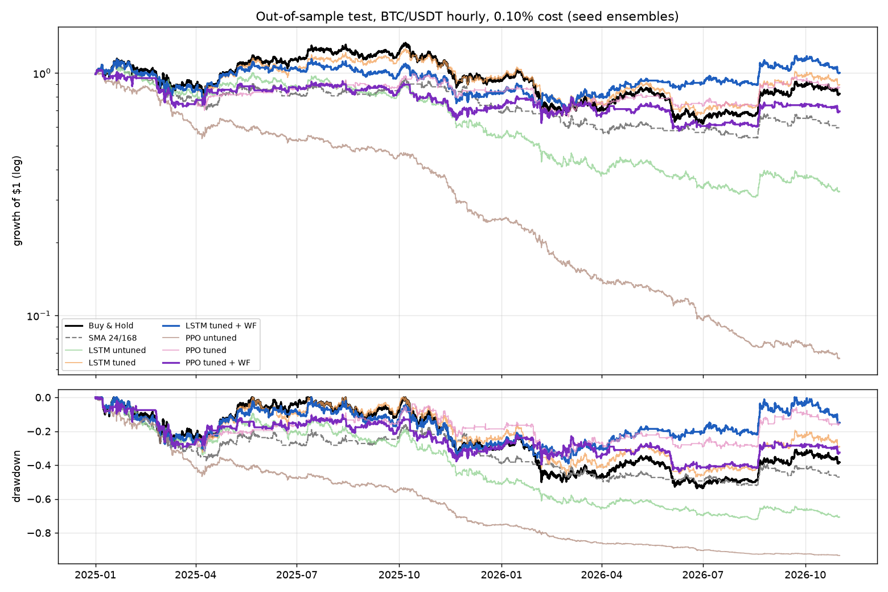

# Crypto Trading: LSTM Forecasting vs. Reinforcement Learning

Two ways to turn machine learning into a BTC/USDT trading strategy, compared under the same
transaction costs, the same features and a strict out-of-sample protocol:

1. **Supervised forecasting:** a PyTorch **LSTM** forecasts the forward return; a rule turns
   the forecast into a long/flat position.
2. **Reinforcement learning:** a **PPO** agent (Stable-Baselines3) learns a trading policy
   directly in a custom Gymnasium environment whose reward is net-of-cost portfolio growth.

Both are tuned with **Optuna** on a validation year, then traded on 22 unseen months
(Jan 2025 to Oct 2026), a period in which BTC fell 17.9%.

## Results (out of sample: Jan 2025 to Oct 2026, 0.1% cost per trade)



| strategy (seed ensemble) | Sharpe [95% bootstrap CI] | total return | max drawdown | trades | Sharpe − B&H (p) |
|---|---|---|---|---|---|
| Buy & hold | −0.03 [−1.35, +1.31] | −17.9% | −53.7% | 1 | |
| SMA 24h/1w crossover | −0.86 [−2.29, +0.64] | −40.5% | −52.0% | 172 | −0.83 (0.92) |
| LSTM, untuned (hourly) | −1.61 [−3.02, −0.07] | −67.6% | −72.3% | 1,140 | −1.58 (1.00) |
| LSTM, tuned | +0.04 [−1.34, +1.43] | −10.6% | −47.1% | 117 | +0.07 (0.41) |
| **LSTM, tuned + walk-forward (primary)** | **+0.18 [−1.16, +1.48]** | **+0.2%** | **−39.0%** | 233 | +0.21 (0.32) |
| PPO, untuned (hourly) | −4.69 [−6.01, −3.29] | −93.4% | −93.4% | 2,847 | −4.66 (1.00) |
| PPO, tuned | −0.09 [−1.42, +1.42] | −12.9% | −38.4% | 277 | −0.06 (0.54) |
| **PPO, tuned + walk-forward (primary)** | **−0.43 [−1.78, +0.95]** | **−30.5%** | **−44.0%** | 270 | −0.40 (0.79) |

Full tables (seed means ± std, validation year, cost sensitivity, volatility overlay, per-quarter
returns, forecast quality): [`results/summary.md`](results/summary.md).

### Findings

1. **Transaction costs decide the outcome.** Before costs the untuned hourly models roughly break
   even (LSTM +1%, PPO +15%); at 0.1% per trade they lose 68% and 93%. Letting Optuna pick the
   decision interval (it chose once a day for both) cut trades 5-10x and was the single biggest
   improvement ([cost sensitivity](results/cost_sensitivity.png)).
2. **The LSTM beat buy-and-hold, but not significantly.** The walk-forward LSTM ensemble finished
   flat (+0.2%) while BTC lost 17.9%, with a smaller maximum drawdown (39.0% vs 53.7%). The paired
   block bootstrap gives p = 0.32 for its Sharpe exceeding buy-and-hold's: on 22 months of data this
   is not distinguishable from luck.
3. **The LSTM works as a trend filter, and its forecast signal decays out of sample.** It is long
   93% of the time in the strongest uptrend decile and 50-65% in the weakest five
   ([behaviour](results/behaviour.png)). Its information coefficient falls from 0.11 on validation
   to ~0.0 to 0.04 on test; the 24-hour return and volume z-score matter most
   ([importance](results/lstm_feature_importance.png)).
4. **PPO learned in-sample but did not generalise.** Training reward rises steadily
   ([curves](results/training_curves.png)), yet results swing across seeds (±21% total return for the single-refit model) and across
   quarterly refits: walk-forward made PPO *worse* (−30.5% vs −12.9%). Its validation edge has a
   Deflated Sharpe Ratio of 0.00 (the LSTM's is 0.63): consistent with the best of 24 trials
   looking good by chance.
5. **Trade-off:** the supervised LSTM was more stable (seed std of Sharpe 0.10 vs 0.34) and easier
   to interpret; the RL agent optimises the true objective (net-of-cost growth) directly but is
   sensitive to seeds, reward design and refits. A volatility-targeting overlay reduced every
   strategy's drawdown by a few points but did not change these conclusions.

Results are reported as they came out of the pre-declared protocol: nothing was re-tuned after
looking at the test period.

## Data and features

* Hourly BTC/USDT spot candles from Binance's public archive (`data.binance.vision`),
  Jan 2019 to Oct 2026: **68,605 candles**, 59 missing hours (forward-filled, zero volume).
* 14 features, each using only data up to the hour's close: log returns (1/4/24/72 h),
  realised volatility (24 h, 1 week), RSI-14, MACD histogram, distance from the 24 h and
  1-week moving averages, volume z-score, high-low range, hour of day. Standardised with
  statistics of the training window only (re-estimated at every refit).

| split | period | hours | used for |
|---|---|---|---|
| train | 2019-01 to 2023-12 | 43,656 | fitting |
| validation | 2024 | 8,784 | early stopping, Optuna, decision threshold |
| test | 2025-01 to 2026-10 | 16,055 | evaluated once, after all tuning |

## Protocol (fixed before the test period was evaluated)

| variant | hyper-parameters | how the test period is traded |
|---|---|---|
| untuned | library defaults, hourly decisions | model fit once on train |
| tuned | Optuna on validation Sharpe | refit once on train + validation |
| **tuned + walk-forward (primary)** | same | **refit every quarter on all data before that quarter**, then trade the quarter |

* Each variant runs 3 seeds; the reported strategy is the **seed ensemble** (LSTM: mean
  forecast; PPO: majority vote). Seed mean ± std is reported too.
* **Costs:** 0.1% per unit of position change (Binance spot taker fee).
* **Decision interval** (1, 4, 12 or 24 h; the position is held in between) is tuned for both
  models; hourly trading is the untuned default.
* **Degenerate-strategy rule:** Optuna rejects strategies in the market less than 10% of the
  time. Otherwise a handful of lucky trades produces a high validation Sharpe; this was
  observed and fixed during development.

## Models

**LSTM** (`src/lstm_model.py`): the last *L* hours of features → LSTM → linear head that predicts
the forward *h*-hour log return (MSE, AdamW, gradient clipping, early stopping). Long when
the forecast exceeds a threshold (in training-target standard deviations), otherwise flat.
Tuned: window *L*, horizon *h*, width, depth, dropout, learning rate, weight decay, decision
interval, threshold.

**PPO** (`src/rl_agent.py`): the observation is the last *w* hours of features plus the current
position; the action is flat or long, held for the decision interval; the reward is 100 × log
portfolio growth net of costs, with an optional penalty on losing hours. Training episodes
are random 30-day windows of the training period; 4 parallel environments; 300k steps.
Tuned: window, learning rate, rollout length, discount, entropy bonus, network width,
downside penalty, decision interval.

## Leakage controls and tests (`tests/test_core.py`)
* The position decided at the close of hour *t* earns only the return from *t* to *t+1*.
* Changing future prices leaves every past feature unchanged (tested).
* LSTM labels that reach into the next period are purged from each training window.
* The environment's reward equals the backtest's P&L for every decision interval (tested).
* Walk-forward fit windows end exactly one hour before each traded quarter (tested).
* Cost accounting, bootstrap and Sharpe-statistics code are unit-tested.

## Statistics (`src/stats.py`, `src/report.py`)
* **Stationary block bootstrap** (Politis & Romano), 1-week mean blocks, 2,000 resamples,
  paired across strategies: Sharpe confidence intervals and the Sharpe difference vs
  buy-and-hold with a one-sided p-value.
* **Probabilistic Sharpe Ratio** and **Deflated Sharpe Ratio** (Bailey & López de Prado): the
  DSR asks whether the validation Sharpe of the tuned model beats what the best of that many
  Optuna trials would reach by luck.
* Robustness: transaction costs from 0 to 20 bps, per-quarter returns, and a volatility-
  targeting overlay (40% annualised target, fixed in advance) applied to every strategy.

## Reproduce

```bash
python -m venv .venv && .venv/Scripts/activate      # or: source .venv/bin/activate
pip install torch --index-url https://download.pytorch.org/whl/cu128   # or the CPU wheel
pip install -r requirements.txt
python src/data.py                                  # download candles
python -m pytest -q tests
python src/run_all.py --quick                       # smoke test of everything (minutes)
python src/run_all.py --part lstm                   # GPU          } can run in parallel
python src/run_all.py --part ppo --workers 10       # CPU workers  }
python src/run_all.py --part report                 # statistics, tables, plots
```

Outputs in `results/`: `summary.md` (every table), `metrics.csv` (every model, variant, seed
and split), `stats.json`, `positions_*.npz` (every position series, so all numbers can be
recomputed), run logs and plots.

## License
MIT.
